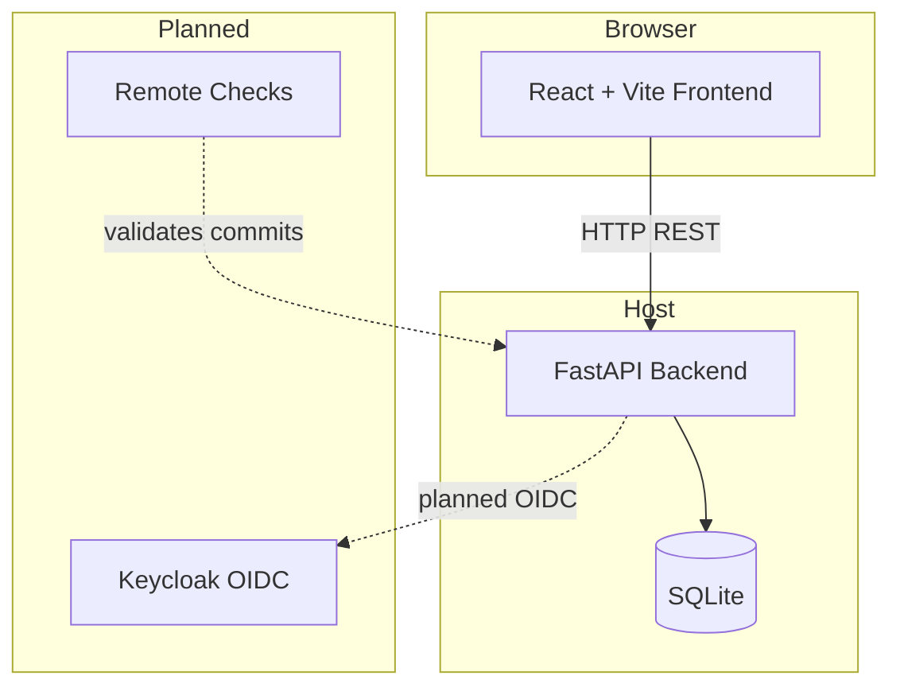

# Cobalt Foundry | Alan Vo | AI & Machine Learning

> Work in progress. This checkpoint may be incomplete or fail tests. See PLAN.md and STATUS.md before use.


Cobalt Foundry solves the problem that GitHub CLI's `gh skill` and `agy plugin
install` cannot discover skills from repositories that organize them under topic
folders two or more levels deep (e.g. `performance/r8-analyzer/SKILL.md`). The
upstream `android/skills` repository has this layout, causing `no skills found`
errors when users try to install by name.

Cobalt Foundry walks any repository layout to discover every `SKILL.md` file at
arbitrary depth, parses metadata, stores them in SQLite, and provides **semantic
search** via a deterministic offline TF-IDF engine with domain keyword expansion.
A developer can describe what they want to do in natural language ("monetization
ads banner") and find the right skill without knowing its exact name or path.

The intended user is an Android developer or AI agent working with GitHub CLI
skills who needs to discover relevant skills from non-standard repository layouts.

## AI/ML Evaluation

**Approach:** TF-IDF (term frequency–inverse document frequency) with cosine
similarity ranking over multi-field skill metadata (title, description, tags,
scope, body). Includes stop-word filtering and domain keyword expansion for
Android development terms (e.g., "r8" expands to "optimization", "shrinking").

**Reproducible command:**

```bash
python3 -m pytest backend/tests/test_search.py -v
```

**Data provenance:** The test fixtures in `backend/tests/fixtures/sample-repo/`
are original sample SKILL.md files modeled after the upstream `android/skills`
repository layout, organized under topic folders (`performance/`, `ads/`, `lint/`).

**Baseline:** TF-IDF cosine similarity with smoothed IDF and title-weighted
fields (title weight 3×, description 2×, tags 2×, scope 2×, body 1×).

**Measured results:** All 79 backend tests pass. Semantic search correctly ranks
the R8 skill first for queries like "optimization" and "r8", and the AdMob skill
first for "monetization" or "ads" queries, via keyword expansion.

**Failure cases:** Search is purely lexical — it cannot understand semantic
meaning beyond token overlap and keyword synonyms. Queries with no matching tokens
return zero results. No LLM is required or available in the offline core.

## Quick Start

```bash
# Backend
python3 -m venv .venv
.venv/bin/pip install -r backend/requirements.txt
.venv/bin/pip install -e .
PYTHONPATH=backend .venv/bin/python -m pytest backend/tests

# Frontend
cd frontend
npm ci
npm run build
npx vitest run

# Run locally
PYTHONPATH=backend .venv/bin/uvicorn app.main:app --host 127.0.0.1 --port 8000
# Open http://localhost:5173 in dev, or use Docker:
docker compose up --build
```

## Architecture



## Features

- **Skill Discovery** — Walk any local repository path to find `SKILL.md` files at
  arbitrary depth. Solves the `gh skill` layout limitation (Issue #48).
- **SKILL.md Parser** — Extract YAML frontmatter (name, scope, title, description,
  tags) and Markdown body with fallbacks to directory-derived values.
- **TF-IDF Semantic Search** — Deterministic offline search with cosine similarity
  and Android domain keyword expansion. No LLM key required.
- **Quality Assessment** — Deterministic metrics (completeness, description
  length, tag count, body words, overall score) for ranking and filtering skills.
- **SQLite Persistence** — SQLAlchemy ORM with UTC timestamps, JSON-encoded tags,
  and an audit log of all indexing operations.
- **React Dashboard** — Vite-built frontend with search, list, detail, index, and
  metrics workflows. Loading, error, and empty states throughout.
- **Docker** — Multi-stage Dockerfiles (backend + frontend) with nonroot users.
  Docker Compose with Keycloak and ntfy services.

## API Endpoints

| Method | Path | Description |
|--------|------|-------------|
| GET | `/api/v1/health` | Health check |
| POST | `/api/v1/skills/index` | Index all SKILL.md under a repo path |
| GET | `/api/v1/skills` | List all skills (filter by scope, paginate) |
| GET | `/api/v1/skills/search?q=` | Semantic search by natural language query |
| GET | `/api/v1/skills/{id}` | Get a single skill by ID (`scope/name`) |
| GET | `/api/v1/metrics` | Quality metrics for all indexed skills |
| GET | `/api/v1/audit-log` | Recent indexing audit entries |

## Security Limitations

- **Authentication is not yet implemented.** All endpoints are open in this round.
  Keycloak OIDC with PKCE authorization-code flow is planned for the next round.
- No rate limiting, no request signing, no audit logging of searches.
- The TF-IDF index is in-memory and rebuilt from the database on demand.
- No TLS termination is configured — the reverse proxy must handle TLS.
- Demo mode (if added) must bind to `127.0.0.1` and refuse to start in production.

## LLM Provider Configuration

| Variable | Required | Default | Description |
|----------|----------|---------|-------------|
| `LLM_API_KEY` | No | — | API key for the selected provider |
| `LLM_PROVIDER` | No | `openai-compatible` | `openai-compatible`, `anthropic`, `gemini`, or `ollama` |
| `LLM_MODEL` | No | — | Model identifier (e.g., `gpt-4o-mini`) |
| `LLM_BASE_URL` | No | — | OpenAI-compatible endpoint URL |

Keys are server-side only. LLM explanations are opt-in, labeled advisory, and
grounded in actual skill records. Provider errors are redacted and never
fabricated. No real keys are committed to the repository.

## SSO / SAML Setup (Planned)

The next round will implement Keycloak OIDC authorization-code login with state +
nonce + PKCE. Keycloak supports upstream SAML IdPs through identity brokering.
Operators configure the realm URL and client credentials via environment
variables. See `docs/deployment.md` for details when implemented.

## Project Layout

```
cobalt-foundry/
├── backend/
│   ├── app/
│   │   ├── core/          # config, database, exceptions
│   │   ├── models/        # SQLAlchemy ORM models
│   │   ├── schemas/       # Pydantic response schemas
│   │   ├── services/      # discovery, parser, search, quality, indexer
│   │   └── api/           # FastAPI routes and dependencies
│   ├── tests/
│   └── Dockerfile
├── frontend/
│   ├── src/
│   │   ├── api/           # Typed API client
│   │   └── components/     # React components
│   ├── public/
│   └── Dockerfile
├── compose.yaml
├── portfolio.json
├── CHANGELOG.md
└── LICENSE
```

## License

MIT License — Copyright (c) 2026 Alan Vo <alanvo@gmail.com>